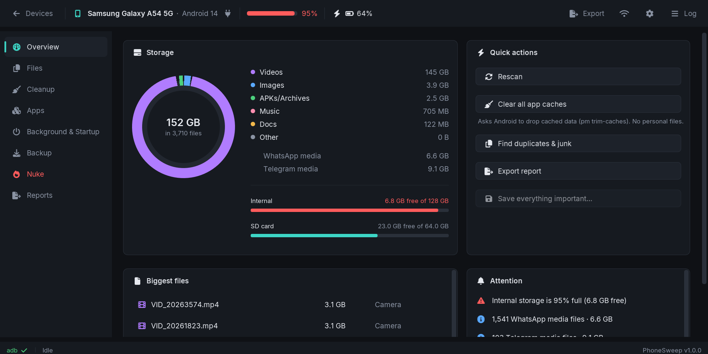
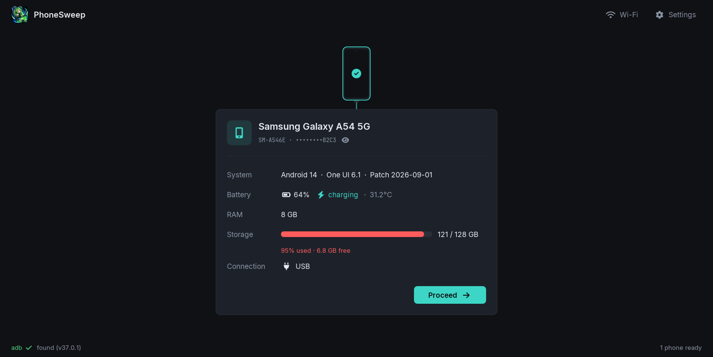
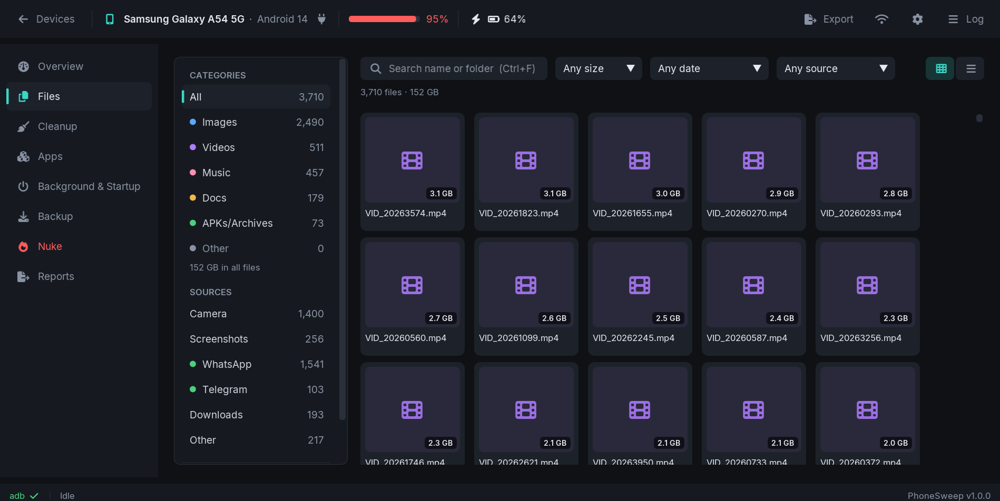

  

<h1 align="center">PhoneSweep</h1>

  <b>Scan, save and clean your Android phone from your Windows PC.</b> 
  See what is filling your phone, back up what matters (checked file by file), and clear the rest safely.

  <a href="https://github.com/KimsFerdy/PhoneSweep/releases/latest"><b>Download for Windows</b></a> ·
  <a href="https://github.com/KimsFerdy/PhoneSweep/issues">Report a problem</a> ·
  <a href="docs/DEVELOPMENT.md">For developers</a>

  

---

## Why PhoneSweep?

Phones fill up with things you never see: duplicate WhatsApp photos, huge 4K videos, thumbnail caches, leftovers from apps you removed years ago, apps that quietly run in the background. Cleaning up on the phone itself is slow and risky: one wrong tap and a photo is gone.

PhoneSweep puts the whole phone on your big screen. You see everything at once, you save what you want to keep to your PC, and only then do you delete. Every copy is verified, so "saved" really means saved.

Works with any Android phone (Samsung, Pixel, Xiaomi, OPPO, Motorola, ...) over a USB cable or Wi-Fi. No app to install on the phone, no account, no cloud.

## What it does

**See everything**
- A full map of your storage: photos, videos, music, documents, archives, on internal storage and the SD card.
- Thumbnails of your photos and videos, filters by folder and source (Camera, WhatsApp, Screenshots, Downloads...).
- Right-click any file to preview it big (zoom photos, play music, read text), open it on the PC, save it, or delete it.
- Every installed app with its size, where it came from (Play Store, other stores, sideloaded) and risk flags such as accessibility access, SMS, call log or overlay permissions.

**Save what matters**
- Copy files and app installers to your PC. Each file is checked after the copy, and a record is kept of what is safely backed up.
- Turn backups into a single zip file, checked again before anything is removed.
- Put a backup back on the phone (or on a new phone) at any time.

**Clean up safely**
- **Duplicate finder:** identical files found by content, not by name. One copy of each always stays. Click a group to see every copy side by side (photos, video frames, music you can play, text files) and delete the extra ones right there.
- **Junk sweep:** thumbnail caches, app caches, leftovers of uninstalled apps, old statuses and logs, sorted into "safe" and "review".
- **Compress** big camera videos and photos (dates, location and rotation kept). Choose whether the smaller copy goes on the phone, the PC, or both.
- **Nuke:** plan a big clean-up, preview exactly what will happen, then confirm.

**Understand your apps**
- Live CPU and RAM use per app, with a "heavy right now" warning.
- Battery use since the last full charge, per app.
- Apps that start at boot or run in the background, and a one-click, reversible way to restrict them.
- Right-click any app: search it on Google Play, ask an AI assistant about it, back it up, or uninstall it (quick, or full with its data and folders).

**Ask any AI**
- Export a report of your phone or copy everything known about one app, ready to paste into ChatGPT, Claude, Gemini, Grok or any other assistant.

**No cable needed**
- Switch a connected phone to Wi-Fi with one click, or pair a phone running Android 11 or newer with a code.

**Always up to date**
- Settings → Updates checks for a new version, shows what changed, then downloads it, installs it and reopens PhoneSweep for you (setup.exe and msi versions).

  
  

## Safety first

PhoneSweep was built around one rule: **you never lose something by accident.**

- **Nuke Protector** (on by default) refuses to delete anything that isn't saved on your PC, anything you marked KEEP, and app folders that hold unsaved files. You can switch to *Nuke free* in Settings if you want full control.
- Every copy to the PC is checked. Every copy back to the phone is checked on the phone before it replaces anything.
- Apps are backed up before they are uninstalled. If the backup fails, the app stays.
- System apps are never uninstalled.
- Big actions show you a preview first, and the dangerous ones ask you to type NUKE.

## Getting started

1. **Download** PhoneSweep from [Releases](https://github.com/KimsFerdy/PhoneSweep/releases/latest):
   - `PhoneSweep-…-setup.exe`: the usual installer (Start menu shortcut, uninstaller; no admin needed).
   - `PhoneSweep-…-x64.msi`: for managed PCs (installs for all users).
   - `PhoneSweep-…-win64.zip`: portable, just unzip and run.

   Windows SmartScreen may warn the first time because the app isn't code-signed yet: click **More info → Run anyway**.
2. **On your phone**, turn on USB debugging:
   Settings → About phone → tap **Build number** 7 times, then Settings → Developer options → turn on **USB debugging**.
   (On Samsung: Settings → About phone → Software information → Build number.)
3. **Plug the phone in** and run `PhoneSweep.exe`. When the phone asks *"Allow USB debugging?"*, tap **Allow**.
4. Pick your phone and start exploring. Nothing is changed on the phone until you confirm an action.

**Requirements:** Windows 10 or 11 (64-bit), an Android phone (Android 7 or newer recommended), a USB cable for the first connection.

**Optional extras**
- **Video thumbnails and video compression:** install [ffmpeg](https://ffmpeg.org/) (for example `winget install ffmpeg`). PhoneSweep finds it automatically.
- **Real app names** instead of package names: install the Android SDK build-tools (PhoneSweep finds `aapt2` automatically).

## Questions

**Is my data sent anywhere?**
No. PhoneSweep talks to your phone and your PC. Backups, reports and settings stay on your computer. "Ask AI" only copies text to your clipboard; you decide where to paste it. The only thing that goes online is the update check: it asks GitHub which version is the newest (nothing about you or your phone is sent), and you can turn it off in Settings → Updates.

**How do I update?**
If you installed with the setup.exe or the msi: Settings → Updates → Download update → Restart and install. PhoneSweep also lets you know at startup when a new version is out. With the portable zip, download the new zip and unzip it over the old folder.

**Where do my backups go?**
`Documents\PhoneSweep\<phone>_<date>\` by default, mirroring the folders on your phone. You can change it in Settings → Backup.

**Can I undo a deletion?**
Deleted files can't be brought back from the phone, which is why PhoneSweep makes you save first. Anything you saved can be restored to the phone from Backup → Restore. Background restrictions can be undone at any time.

**Does it need root?**
No. Everything works with normal USB debugging.

**The phone isn't showing up.**
Check that USB debugging is on, that the cable supports data (not just charging), and that you tapped *Allow* on the phone. Try another USB port. If it still doesn't work, please [open an issue](https://github.com/KimsFerdy/PhoneSweep/issues).

## What's next

- **v1.1:** compare duplicate copies side by side, right-click and big preview for files, and updates from inside the app.
- **v1.2 – v1.9:** more quality-of-life updates: polish, speed and fixes for what you report.
- **v2.0:** upload to Google Drive, an automatic Nuke queue for files you haven't used in a while, PhoneSweep apps for Android and iPhone, PC Sweep for Windows, macOS and Linux, and PhoneSweep Watcher.

Read the full [roadmap](docs/ROADMAP.md).

## Credits

Made by **Kims Ferdy** and his humble friend **Claude**.

- Instagram: [@kimscode_studio](https://www.instagram.com/kimscode_studio/)
- ArtStation: [kimscode_studio](https://www.artstation.com/kimscode_studio)

PhoneSweep uses [Dear ImGui](https://github.com/ocornut/imgui), [stb](https://github.com/nothings/stb), [nlohmann/json](https://github.com/nlohmann/json), [FreeType](https://freetype.org/), the Inter, JetBrains Mono and Font Awesome Free fonts, and `adb` from the Android Open Source Project. Thanks to all of them.

Bugs and ideas are welcome on the [issue tracker](https://github.com/KimsFerdy/PhoneSweep/issues).

## License

PhoneSweep is free and open source under the [MIT License](LICENSE).
